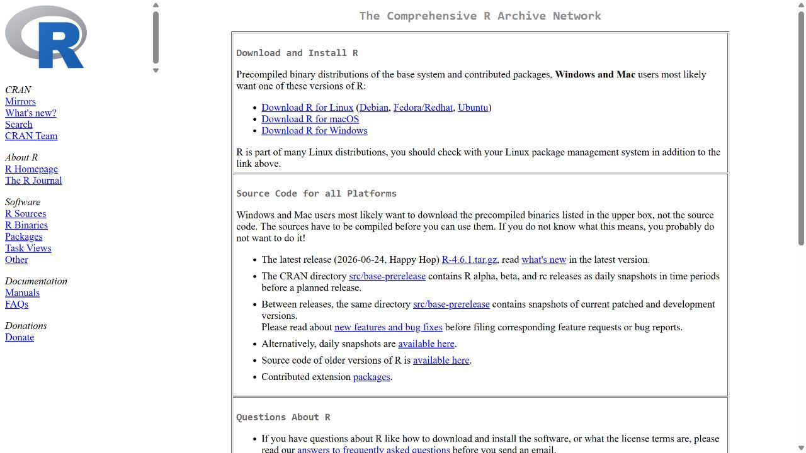
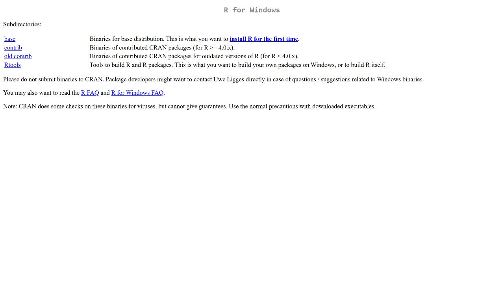
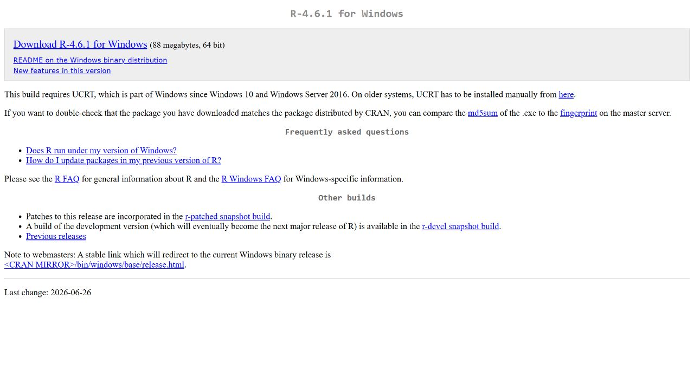
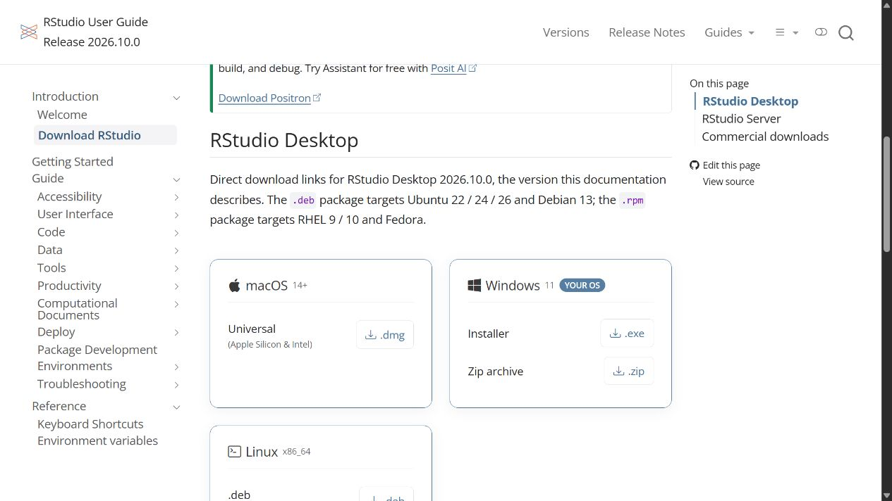

# Getting started with R {#sec-start}

## Learning outcomes

After this chapter, you should be able to explain the roles of R and RStudio in agricultural research, identify the observations and units in an agricultural dataset, create an RStudio project, run and save commands, and install and load a package.

## R and RStudio in agricultural research {#statistical-software}

Agricultural researchers collect observations to answer practical questions: Does a new variety yield more? How do soil nutrient levels vary between fields? What is the response to fertilizer? How does a crop grow through the season? This book teaches you to address such questions using **R for analysis and RStudio as your working environment**. You will learn to organize observations, inspect their quality, calculate summaries, draw useful graphs, fit appropriate statistical models, and explain the results in agricultural terms.

### What R does and what RStudio provides

**R** is a programming language and environment for statistical computing and graphics. You give it instructions, store observations as objects, and use functions to carry out calculations. An R script records those instructions so you can check an analysis, correct a mistake, or repeat the work with a new dataset. Packages add functions for tasks such as importing Excel files, manipulating data, plotting, and analysing experiments.

**RStudio** is the interface used for the practicals in this book. Its script editor helps you write and save R commands; its Console runs them; and its supporting panes let you inspect objects, browse files, view plots, and read help. R performs the calculations. RStudio helps you manage the work. Install R first, then RStudio, and keep each research project in its own folder.

Agricultural scientists and students need not become professional software developers. They should, however, understand the commands they use, the observations entering an analysis, and the meaning of its output. Learning R through a research question gives each command a purpose.

### Applications across agricultural research

The following examples show how the skills developed in this book contribute to agricultural investigations.

| Agricultural question | Observations to organize | Work you will do in R |
|---|---|---|
| Do varieties or management treatments differ in yield? | Plot identifiers, treatments, blocks or replicates, and yield with its units | Inspect treatment variation, draw comparative plots, and analyse treatment effects using the experimental design. |
| How do soil characteristics vary between fields? | Sampling locations, depth, pH, organic carbon, and nutrient measurements | Check missing values and unusual observations, summarize soil properties, and explore relationships. |
| How does a crop grow during the season? | Plant or plot identifiers, observation dates, and growth measurements | Plot growth trajectories, fit growth models, and interpret their parameters. |
| How do rainfall and temperature vary over time? | Dates, rainfall, temperature, and measurement units | Visualize time series, examine trends and seasonality, calculate moving averages, and assess forecasts. |

Begin by identifying what each row represents. A plot, plant, soil sample, and repeated measurement are different observational units. Preserve treatment and replicate identifiers when importing or cleaning data. Repeated observations on the same plant or plot must not be treated automatically as independent replicates. R can calculate a result even when the data structure or analysis is inappropriate; the researcher must choose a method consistent with the question and design.

### From a field notebook to a reproducible analysis

A useful R workflow follows the research process:

1. **Organize:** define variables and units, retain the original observations, and import a working copy into R.
2. **Inspect:** check data types, missing values, duplicates, and possible entry errors before changing the data.
3. **Explore:** use numerical summaries and plots to understand variation and relationships.
4. **Analyse:** choose a statistical method suited to the experimental design and check its assumptions.
5. **Communicate:** report estimates and uncertainty with an agricultural interpretation, then save the script and exported results.

Software supports statistical reasoning; it does not replace it. Strengthen your understanding of sampling, experimental design, and statistical inference alongside the R practicals. My [Textbook of Agricultural Statistics](https://kaumelon.github.io/stat3202/) provides a companion reference for the statistical concepts. The chapters that follow develop this workflow through detailed R commands, worked agricultural examples, and practical exercises.

[**RAISINS**](https://www.raisins.live/){#raisins} is a browser-based platform that offers a graphical route to agricultural data analysis, including statistical summaries and experimental-design analyses. It can complement learning in R by letting students compare a guided analysis with their own R script. Whatever interface is used, students must check the design, assumptions, and interpretation of the results.

## R and RStudio: the illustrated guide

::: {.callout-note title="Using the illustrated installation guide"}
The download screenshots below were updated on 16 October 2026. The original pane illustration is labelled as historical. Release numbers and screen layouts change; use the official download links given in the text.
:::

This training program is tailored to equip you with the skills needed for agricultural data analysis using R and RStudio. In this introductory section, we will provide you with a brief overview and guide you through the process of installing R and RStudio.  


### R  
R is a programming language for statistical computing and graphics supported by the R Core Team and the R Foundation for Statistical Computing. Created by statisticians Ross Ihaka and Robert Gentleman. R is an implementation of the S programming language. R is used among data miners, bioinformaticians and statisticians for data analysis and developing statistical software. Users have created packages to augment the functions of the R language.
According to user surveys and studies of scholarly literature databases, R is one of the most commonly used programming languages used in data mining. The official R software environment is an open-source free software environment within the GNU package, available under the [GNU General Public License](https://www.gnu.org/licenses/gpl-3.0.en.html). It is written primarily in C, Fortran, and R itself (partially self-hosting). R has a command line interface. Multiple third-party graphical user interfaces are also available, such as RStudio, an integrated development environment.  

```{r fig-original-03-rlogo, echo=FALSE,fig.cap='R logo',out.width="30%", fig.align='center'}
knitr::include_graphics(rep("images/downloadR/rlogo.png"))
```

### Rstudio  
RStudio is an integrated development environment (IDE) for R. It includes a console, syntax-highlighting editor that supports direct code execution, as well as tools for plotting, history, debugging and workspace management. RStudio is available in open source and commercial editions and runs on the desktop (Windows, Mac, and Linux) or in a browser connected to RStudio Server. RStudio is a free and open-source integrated development environment (IDE) for R, a programming language for statistical computing and graphics. JJ Allaire, creator of the programming language ColdFusion, founded RStudio. RStudio is available in two editions: RStudio Desktop, where the program is run locally as a regular desktop application; and RStudio Server, which allows accessing RStudio using a web browser while it is running on a remote Linux server.  

The original RStudio interface used the Qt framework; the current desktop application uses Electron. RStudio combines components written in several programming languages. Work on RStudio started at around December 2010, and the first public beta version (v0.92) was officially announced in February 2011.  

```{r fig-original-03-rstudio1, echo=FALSE,fig.cap='R studio logo',out.width="30%", fig.align='center'}
knitr::include_graphics(rep("images/downloadR/rstudiologo.png"))
```

Typical RStudio window has four panes as explained below  

```{r fig-original-03-rstudio2, echo=FALSE,fig.cap='RStudio pane layout from the original lecture notes; appearance varies in current releases',out.width="80%", fig.align='center'}
knitr::include_graphics(rep("images/downloadR/rstudiowindow.png"))
```

1. **Console**

This is where the action happens. Here any authentic R code typed after the ‘>’ prompt will be executed after pressing ‘Enter’ to generate the output. We will use the Console to run and inspect the commands developed in this book.  

2. **Source Editor**

This is where R scripts (collection of code) can be created and edited. New R script can be opened by clicking File --> New File --> R Script or using short cut `ctrl+shift+N`. You can type your codes here. To run a code in console or execute, place the cursor in the line which code is written and press `ctrl+enter` or highlight the code you wish to evaluate and clicking on the “Run” button on the top right of the Source. You can save your R codes, written in script.   

3. **Environment|History|Connections**

All of the data objects (such as vectors, matrices, and dataframes) that you have defined in your current R session are listed under the Environment tab of this panel. In data objects, you may also examine details like the quantity of observations and rows. A few other clickable options are available on the tab, such as `Import Dataset`, which will launch a graphical user interface (GUI) for inputting data into R.  

This panel's History tab only provides a history of all the code that you have previously evaluated in the Console.  

The Environment / History panel could be helpful as you become more accustomed to R. However, you can ignore it right now. You can simply just reduce the window by clicking the minimise button in the panel's upper right corner if you wish to clear up space on your screen. 

4. **Files|Plots|Packages|Help|Viewer**  

You can find a collection of useful information in the Files|Plots|Packages|Help panel. Let's examine each tab in more detail:  
- The file directory on your hard disc is accessible through the files panel. You can utilise the "Files" panel to set your working directory by clicking "More" and then "Set As Working Directory" once you've navigated to the folder where you wish to read and save files.  

- All of your plots are displayed in the Plots panel. There are buttons to export the plot as a pdf or jpg and to open the plot in a separate window.  
We are interested in the install button in this pane, to install packages required for our analysis.

### Installing the current R release

::: {.callout-note title="Installation guide updated 16 October 2026"}
At the date of this update, CRAN offers **R 4.6.1** for Windows and Posit offers **RStudio Desktop 2026.10.0, build 233**. The screenshots below are genuine captures of the official download pages on that date. Download the stable release displayed when you study this chapter; the version number will change. These are download-page screenshots, rather than screenshots of an installer running on your computer.
:::

Install **R first**, then **RStudio Desktop**. R performs the calculations; RStudio provides the editor and working environment.

#### Step 1: choose your operating system

Open [CRAN](https://cran.r-project.org/). Choose **Download R for Windows** on a Windows computer. macOS users should select the macOS download and the installer appropriate to their processor; Linux users should follow CRAN's instructions for their distribution.

{width=100%}

#### Step 2: choose the base installation

On the Windows page, select **base** or **install R for the first time**. Rtools is a separate collection of build tools; it is not the R application. Students installing precompiled Windows packages can begin with base R.

{width=100%}

#### Step 3: download and install R

Open the [current Windows release page](https://cran.r-project.org/bin/windows/base/) and select its **Download R** link. At this update it offers R 4.6.1. Check the operating-system requirement on the page: the current R Windows release requires Windows 10 or later and the Universal C Runtime (UCRT).

{width=100%}

After downloading, open the installer from your Downloads folder. Select the installation language, read the installation information, and follow **Next** through the destination and component choices. The defaults are suitable for a typical first installation. Allow installation to finish, then select **Finish**. Open R from the Start menu to confirm that its console launches. The exact installer screens depend on the release and your system permissions; an institution-managed computer may require laboratory support.

### Installing RStudio Desktop

#### Step 4: download the free desktop edition

Open the [official RStudio download page](https://docs.posit.co/ide/user/download.html). Choose **RStudio Desktop**, then the installer matching your operating system. The current Windows card lists **Windows 11**; do not assume RStudio and R have identical operating-system requirements. Select the open-source Desktop installer, rather than the Server or commercial Pro editions, for the course.

{width=100%}

Run the downloaded RStudio installer and follow its installation steps. Launch **RStudio** after completion. RStudio should detect the installed R; if asked to select an R installation, choose the current installation you just installed. On macOS, open the downloaded disk image and follow the application's installation instructions. Linux users should select the package for their distribution.

#### Step 5: verify the R session

Type the following in RStudio's **Console**, without typing the `>` prompt. These commands report the version actually running on your computer and perform a small calculation.

```{r}
R.version.string
2 + 3
```

The version printed in this textbook's rendered output is the R installation used to build the book; it need not match the latest downloadable release. Your calculation should return `5`.

Create a script with **File → New File → R Script**, enter `2 + 3`, and press **Ctrl+Enter** (Windows/Linux) or **Command+Enter** (macOS). Save the script as `first-practical.R`. If the Source pane is initially absent, opening a script reveals it. The Console, Source, Environment, and Files/Plots/Help areas are described above; modern RStudio also supports an optional Sidebar and customizable pane layouts. See the [current official pane guide](https://docs.posit.co/ide/user/ide/guide/ui/ui-panes.html).

::: {.callout-tip title="Checkpoint before the first practical"}
You can open RStudio, run `2 + 3`, save an R script, and identify the R version in your Console. Next create a course project and install the packages used in the practicals. Keep an internet connection for the initial package installation.
:::

The original installation pictures are retained with the archived lecture notes in `source-notes/` and `images/downloadR/`; the teaching instructions above use the updated download pages.

##### The above descriptions are sourced from: {-}

[The R Project for Statistical Computing](https://www.r-project.org/)

[RStudio](https://www.rstudio.com/)

[Wikipedia R (programming language)](https://en.wikipedia.org/wiki/R_(programming_language))

[Wikipedia RStudio](https://en.wikipedia.org/wiki/RStudio)

## Packages and libraries

### Packages
Packages are organised collections of R functions, data, and compiled code. Packages have useful functions to perform specific tasks. Some of the useful packages for agricultural research are `agricolae`, `grapesAgri1` etc.  
In the R environment, packages are kept in a directory called "library". R installs a group of packages by default during installation. Only the default packages are initially available once the R console has been launched. The R application that is getting to use other installed packages needs to be explicitly loaded from package library in order to use them.

### Repositories  

A repository is where packages are located so that they can be installed from it. Organizations and developers each have their own local repository, which is often online and open to all. The most well-liked R package repositories include: **CRAN**, **BIOCONDUCTOR**, **GITHUB**.  

#### CRAN
**C**omprehensive **R** **A**rchive **N**etwork(**CRAN**) is the official repository, It is an international network of ftp and web servers run and managed by the R community. It is coordinated by the R community, and before a package can be published in CRAN, it must pass a number of tests to guarantee that it complies with CRAN rules.  

#### Bioconductor 
Open source software for bioinformatics is designed for the topic-specific repository known as Bioconductor. In keeping with CRAN, it has its own submission and review procedures, and its community is quite active, holding numerous conferences and meetings each year.  

#### Github  

The most well-known repository for open source projects is Github. Its popularity is due to the unrestricted open source storage space, integration with the version control programme git, and simplicity of sharing and teamwork.  

### Base packages  

Base packages or standard pacakges come pre-installed with R installations and are regarded as being a part of the R source code. The fundamental R functions are found in base packages, which make it possible to perform common statistical and graphical operations on datasets. Examples of Base packages include `stats`, `graphics`, `grDevices`, `utils`, `datasets`, `methods` and `base`. The functions available in these Base packages can be used for basic operations on the data set. Some of the functions we have discussed earlier in Section @sec-language, like `mean()`,`min`, `log10`,`as.data.frame` etc.  

The standard installation contains base packages for essential language, statistical, graphics, and utility functions. The exact installed list can be inspected with `installed.packages()`.

In addition, there are fifteen "recommended packages" from CRAN which are included with binary distributions of R: `KernSmooth`, `MASS`, `Matrix`, `boot`, `class`, `cluster`, `codetools`, `foreign`, `lattice`, `mgcv`, `nlme`, `nnet`, `rpart`, `spatial`, and `survival`.

### Other packages  

Any user could develop a package and make it available through any of the repositories. There are thousands of helpful R packages.  

### Installing R Packages  

There are numerous ways to install R Packages, which are listed below. You need an active internet connectivity for installing packages.  

#### From CRAN  

Installing Packages From CRAN: For installing Package from `CRAN` we need the name of the package and use the following command:  

```{r original-05-1, eval=FALSE}
install.packages("package name")  
```  
Simply express package name as a character vector in the first argument of the `install.packages()` function to install more than one package at once:  

```{r original-05-2, eval=FALSE}
install.packages(c("grapesAgri1", "MASS"))  
```  

#### From Bioconductor

Bioconductor provides packages for biological data analysis. The original notes used `biocLite()`. That installation mechanism has been replaced by `BiocManager`. The distinction between installing its manager and installing a selected package remains useful.

```{r}
#| eval: false
if (!requireNamespace("BiocManager", quietly = TRUE)) {
  install.packages("BiocManager")
}
BiocManager::install(c("GenomicFeatures", "AnnotationDbi"))
```

Consult the [official Bioconductor installation guide](https://www.bioconductor.org/install/) for compatibility with your R version. These optional examples are not executed while building the textbook.

#### From github  

To install a R package from github, start by installing the devtools package. The best way to do this is from CRAN.  

```{r original-05-6, eval=FALSE}
install.packages("devtools")  

```  

Install the package of interest from GitHub using the following code, where you need to remember to list both the author and the name of the package. In this example, we are installing the `grapesAgri1` package created by *pratheesh3780*.  

```{r original-05-7, eval=FALSE}  
devtools::install_github("pratheesh3780/grapesAgri1")  

```

### Load packages  

Once you successfully install an R package; you need to load the package for use in the session. `library()` function can be used to load package. 

**Example**  
```{r original-05-8, eval=FALSE}  
library(grapesAgri1)
```  

#### Load Multiple Packages at Once  

We need to first specify a vector of package names:  
```{r original-05-9, eval=FALSE}  
my_packages <- c("dplyr", "mice", "stringr") # vector of package names 
lapply(my_packages, require, character.only = TRUE)    # Load multiple packages  
 
```
After running the code, inspect the returned logical values: `require()` returns FALSE for packages it could not load. Do not assume that every package loaded successfully.  


### Check, Update and Remove  

To check what packages are installed on your computer, type this command:  

```{r original-05-10, eval=FALSE}
installed.packages()  
```  

To update all the packages, type this command:  

```{r original-05-11, eval=FALSE}  

update.packages()  
```   

To update a specific package, type this command:`install.packages("package name")`  

```{r original-05-12, eval=FALSE}  

install.packages("grapesAgri1")  

```

### Installation using R studio UI  

The packages can be installed using Rstudio User interface. Step by step installation of package `grapesAgri1` is shown below. All other packages can be installed in similar way  

-  **Step 1**: Click on the install button as shown below 

```{r fig-original-05-1, echo=FALSE,fig.cap='Step 1',out.width="80%", fig.align='center'}
knitr::include_graphics(rep("images/packages/1.PNG"))
```    

-  **Step 2**: Type the name of the package in the window that appears

```{r fig-original-05-2, echo=FALSE,fig.cap='Step 2',out.width="80%", fig.align='center'}
knitr::include_graphics(rep("images/packages/2.PNG"))
```  

-  **Step 3**: Select the package name and click install  

```{r fig-original-05-3, echo=FALSE,fig.cap='Step 3',out.width="80%", fig.align='center'}
knitr::include_graphics(rep("images/packages/3.PNG"))
```  

-  **Step 4**: Load the package name by clicking on the check box.  

```{r fig-original-05-4, echo=FALSE,fig.cap='Step 4',out.width="80%", fig.align='center'}
knitr::include_graphics(rep("images/packages/4.PNG"))
```

## Agricultural applications, interpretation, and further practice

### Why use a programming language?

A spreadsheet is convenient for recording observations. A script records the operations performed on them. If a corrected observation arrives, the script can repeat the same analysis. This makes a programming language valuable even for a modest experiment.

R evaluates instructions and stores results as objects. RStudio is an integrated development environment that helps edit scripts, inspect objects, and view plots. R and RStudio are installed separately; both are used in the practicals.

Download R from [CRAN](https://cran.r-project.org/) and RStudio Desktop from [Posit](https://posit.co/download/rstudio-desktop/). Follow the installer for your operating system. Open RStudio and create a project in a folder for the course. Keep raw data in `data/`, scripts in `scripts/`, and exported results in `outputs/`. Avoid hard-coded drive names so your work can run on another computer.

The Source pane holds saved scripts; the Console evaluates commands; the Environment pane lists objects; and the Files, Plots, Packages, and Help tabs provide supporting tools. Pane positions may differ. In the Source pane, Ctrl+Enter on Windows runs the selected code or current line. Save your script even when the commands also appear in Console history.

### A first agricultural calculation

Suppose a 20-square-metre harvested plot produces 9.6 kg of grain. One hectare contains 10,000 square metres, and one tonne contains 1,000 kg.

```{r}
grain_kg <- 9.6
plot_area_m2 <- 20
yield_t_ha <- grain_kg / plot_area_m2 * 10000 / 1000
yield_t_ha
```

The answer is 4.8 t/ha. The expression makes the unit conversion explicit. It does not adjust for grain moisture, harvested border rows, or sampling errors; those require additional information. Names such as `grain_kg` help prevent unit mistakes.

`<-` assigns a value. A line beginning with `#` is a comment. R is case sensitive: `grain_kg` and `Grain_kg` are different names. The Console's `>` prompt is not part of the code. A `+` prompt usually means that a bracket or quotation mark has not been closed; press Escape and inspect the command.

### Packages and help

A package supplies functions, documentation, and sometimes datasets. Install a package once into an R library, then load it in each new session where it is needed. Installation should be a deliberate setup step, not part of rendering an analysis.

```{r}
#| eval: false
install.packages(c("dplyr", "ggplot2", "readxl"))
library(dplyr)
?mean
example(mean)
```

The notation `dplyr::filter()` calls a function explicitly from a package. It is useful when packages provide functions with the same name. For Bioconductor packages, use the current Bioconductor installation instructions and `BiocManager`; the old `biocLite()` approach in the earlier notes is obsolete.

### Errors are information

“Object not found” suggests a misspelt name, an unrun assignment, or an object from a previous session. “Could not find function” suggests a misspelling or an unloaded package. “Cannot open file” suggests an incorrect relative path. Start with the first error and run a small piece of code that reproduces it. Restart R periodically and run your saved script from the beginning; this reveals hidden dependencies on old objects.

### Practical 1 and exercises

1. Create a course project and save a script containing the yield calculation. Change the harvested mass to 11.2 kg. State the new yield and its unit.
2. Explain why `9.6 / 20` is not yet a yield in t/ha.
3. Deliberately type `Grain_kg`, read the error, and correct it.
4. Find the help for `sqrt()` and calculate the square root of 144.

**Chapter review.** A saved script records an analysis; a project makes file paths portable; packages extend R; and units remain the analyst's responsibility.

## Live R laboratory

::: {.live-r}
**Your first agricultural calculation**

Edit the code, then select **Run R**. The first run downloads R into your browser and may take a little time. **Copy code** also lets you use this example in RStudio.

```r
yield_t_ha <- c(3.2, 3.8, 4.1, 3.5, 4.4)
mean(yield_t_ha)
range(yield_t_ha)
length(yield_t_ha)
```

**Investigate.** The five simulated plot yields have a mean of 3.8 t/ha. Change the last yield to 5.4. Predict how the mean and range will change before running again.
:::

::: {.callout-tip title="From the browser to your practical notebook"}
Record the input you changed, the output you obtained, and your interpretation. These live examples use base R and work independently. The full chapter examples, including package-based analyses, remain available with copy buttons for RStudio. Browser objects last until this page is reloaded; Reset code restores the editor text. Internet access is needed on first use; long or interactive desktop tasks belong in RStudio.
:::

::: {.callout-caution title="Historical Insights"}
R was created by Ross Ihaka and Robert Gentleman at the University of Auckland, New Zealand, in the early 1990s as a free implementation of the S language. Version 1.0.0 of R was released on 29 February 2000. Its name comes partly from the first letters of its two authors' names.
:::

## Chapter Summary

### Fill in the blanks {.unnumbered}

Answers are given at the end of the chapter.

1. R is a free and open-source programming language and environment for statistical __________ and graphics.
2. RStudio is an integrated development __________ for R.
3. The four panes of RStudio are the source editor, the console, environment/history and the __________ / plots / packages / help pane.
4. Organised collections of R functions, data and documentation are called __________.
5. The official repository of contributed R packages is __________.
6. A package is installed once with `install.packages()` but must be loaded in every session with __________.
7. Before installing RStudio you must first install __________.
8. The smallest unit to which a treatment is independently applied is the experimental __________.

### Short-answer questions {.unnumbered}

1. Distinguish between R and RStudio.
2. Why is a script preferable to typing commands only in the console?
3. What is an RStudio project and why is it useful?
4. Explain the difference between installing and loading a package.
5. Name three repositories from which R packages can be installed.

### Numerical and conceptual questions {.unnumbered}

Answers are given at the end of the chapter.

1. A plot of 20 m^2^ yields 11.2 kg of grain. Express the yield in t/ha.
2. A 1.5 m × 2 m plot yields 450 g of seed. Express the yield in kg/ha.
3. In a pot experiment each pot holds four plants and the treatment is applied to the pot. What is the experimental unit, and how many replicates does an experiment with 6 pots per treatment have?

### Important formulae {.unnumbered}

Yield in tonnes per hectare from a plot harvest in kg and plot area in m^2^:

$$
\text{Yield (t/ha)} = \frac{\text{harvest (kg)}}{\text{plot area (m}^2)} \times 10
$$ {#eq-ch1-yield}

Yield in kilograms per hectare:

$$
\text{Yield (kg/ha)} = \frac{\text{harvest (kg)}}{\text{plot area (m}^2)} \times 10\,000
$$ {#eq-ch1-kgha}

### Quick revision {.unnumbered}

- R → the language that does the computing; RStudio → the window in which you write, run and save R code.
- Scripts and projects → analyses that can be rerun, checked and shared.
- `install.packages()` → once per computer; `library()` → once per session.
- Errors → information: read the message, check spelling, brackets and object names.
- Always identify the experimental unit before analysing agricultural data.

### Answers to fill in the blanks {.unnumbered}

::: {.answer-key}
`1.` computing `2.` environment `3.` files `4.` packages `5.` CRAN `6.` `library()` `7.` R `8.` unit
:::

### Solutions to numerical and conceptual questions {.unnumbered}

1. Using @eq-ch1-yield, $11.2/20 \times 10 = 5.6$ t/ha.
2. Area $=3$ m^2^; by @eq-ch1-kgha, $0.45/3 \times 10\,000 = 1500$ kg/ha.
3. The pot is the experimental unit; there are 6 replicates per treatment, not 24.
