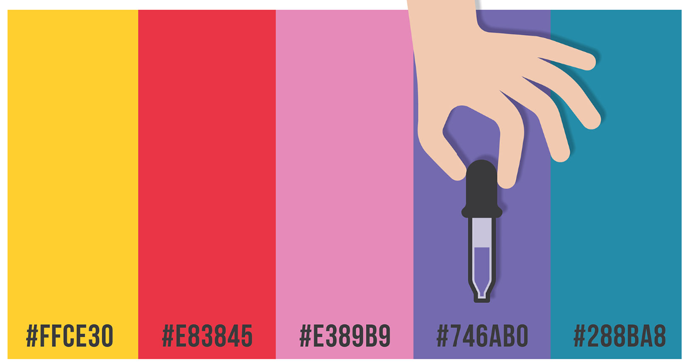
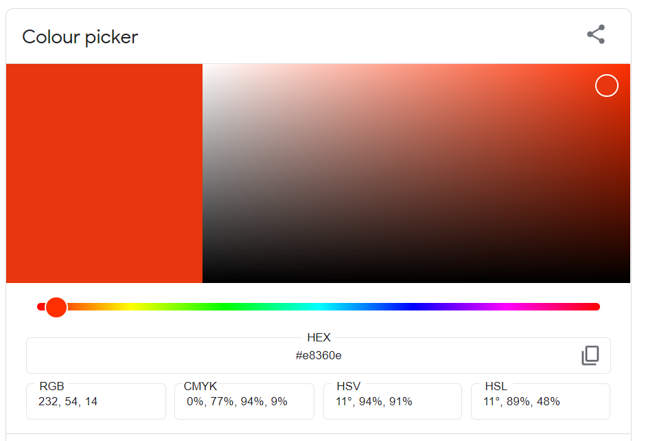

# Graphical representation {#graphical-representation}

A good graph often reveals more about data than a table of numbers. This chapter shows how to draw the commonly used graphs with **base R graphics**, and ends with a short introduction to the `ggplot2` package. The following graphs are covered:

- Bar plot (bar chart)
- Pie chart
- Histogram and density plot
- Box plot
- Scatter plot and scatter-plot matrix
- Line plot
- Plot of treatment means with error bars

## Bar plot

Suppose we have the maximum temperatures (°C) recorded on seven days:

```{r bar}
max.temp <- c(22, 27, 26, 24, 23, 26, 28)
```

A bar plot of the data:

```{r bar1}
barplot(max.temp)
```

The appearance of the plot is controlled by arguments to `barplot()`; see the help page with `?barplot`. The most often used are:

- `main` – the title
- `xlab`, `ylab` – axis labels
- `names.arg` – labels for the bars
- `col` – colour of the bars
- `horiz = TRUE` – draw the bars horizontally

```{r bar2}
# bar chart with added parameters
barplot(max.temp,
  main = "Maximum temperatures in a week",
  xlab = "Day",
  ylab = "Temperature (°C)",
  names.arg = c("Sun", "Mon", "Tue", "Wed", "Thu", "Fri", "Sat"),
  col = "#F9E79F" # hex colour code
)
```

With `horiz = TRUE` the bars run horizontally, so the axis labels swap roles:

```{r bar3}
barplot(max.temp,
  main = "Maximum temperatures in a week",
  xlab = "Temperature (°C)",
  ylab = "Day",
  names.arg = c("Sun", "Mon", "Tue", "Wed", "Thu", "Fri", "Sat"),
  col = "#85C1E9",
  horiz = TRUE,
  las = 1 # write the day labels horizontally
)
```

### Bar plot of frequencies and grouped bar plot

For a categorical variable, first count the frequencies with `table()`. A two-way table gives a grouped (or stacked) bar plot. The `ToothGrowth` data (Chapter \@ref(dataset)) records the delivery method (`supp`) and dose for each animal:

```{r bar4}
tab <- table(ToothGrowth$supp, ToothGrowth$dose)
tab

barplot(tab,
  beside = TRUE, # side-by-side bars; FALSE gives stacked bars
  col = c("#E59866", "#76D7C4"),
  legend.text = TRUE,
  xlab = "Dose (mg/day)", ylab = "Number of animals"
)
```

### Hex colour codes

Hexadecimal codes are a precise way to specify a colour. When you want your graph to have a particular colour, you give its hex code.

```{r hex, echo=FALSE, fig.cap='Hex codes for colour', out.width="80%"}

```

A hex colour code starts with a hash symbol (`#`) followed by six symbols in three pairs. Each pair is a number from 0 to 255 written in base 16 (00 to FF):

- Pair 1: red value
- Pair 2: green value
- Pair 3: blue value

For instance, the RGB value (224, 105, 16) is written `#E06910`. In all, $256^3$ (more than 16 million) colours can be specified this way.

**Popular hex codes**

**Colour**|**RGB**|**Hex colour code**
:-----:|:-----:|:-----:
Black|(0, 0, 0)|#000000
Blue|(0, 0, 255)|#0000FF
Grey|(128, 128, 128)|#808080
Green|(0, 128, 0)|#008000
Purple|(128, 0, 128)|#800080
Red|(255, 0, 0)|#FF0000
White|(255, 255, 255)|#FFFFFF

R also accepts 657 colour names such as `"steelblue"` or `"darkgreen"` (see `colors()`), and the function `rgb()` converts RGB values to a hex code: `rgb(224, 105, 16, maxColorValue = 255)`.

#### How to get hex codes

You can find the hex code of any colour with a [colour picker](https://g.co/kgs/91J9Do). Copy the hex code and use it in your R code.

```{r hex1, echo=FALSE, fig.cap='Colour picker', out.width="80%"}

```

## Pie chart

A pie chart shows the share of each category in a whole. The area under five crops in a hypothetical farm (ha):

```{r pie}
area <- c(Rice = 12, Coconut = 8, Banana = 5, Vegetables = 3, Pulses = 2)
pct <- round(area / sum(area) * 100, 1)

pie(area,
  labels = paste0(names(area), " (", pct, "%)"),
  col = c("#F7DC6F", "#82E0AA", "#F0B27A", "#85C1E9", "#D7BDE2"),
  main = "Area under crops"
)
```

::: {.rmdnote}
The eye compares lengths better than angles, so a bar plot is usually a better choice than a pie chart, especially when there are more than four or five categories.
:::

## Histogram

A histogram shows the frequency distribution of a continuous variable. The range is split into class intervals (bins) and the height of each bar is the frequency in that class.

```{r hist}
hist(iris$Sepal.Length,
  main = "Histogram of sepal length",
  xlab = "Sepal length (cm)",
  col = "#AED6F1", border = "white"
)
```

By default R chooses the classes with Sturges' rule (Chapter \@ref(descriptive-statistics)). The `breaks` argument sets the number of classes or the actual break points. With `freq = FALSE` the bars show densities, so a smooth density curve can be overlaid:

```{r hist2}
hist(iris$Sepal.Length,
  breaks = seq(4, 8, by = 0.25), freq = FALSE,
  main = "Histogram with density curve",
  xlab = "Sepal length (cm)",
  col = "#D5F5E3", border = "white"
)
lines(density(iris$Sepal.Length), lwd = 2, col = "darkgreen")
```

## Box plot

A box-and-whisker plot (box plot) shows the five-number summary of a data set: the minimum, first quartile ($Q_1$), median, third quartile ($Q_3$) and maximum, and it flags possible outliers.

### Anatomy of a box plot

Figure \@ref(fig:box) shows the parts of a box plot.

```{r box, echo=FALSE, fig.cap='Anatomy of a box plot. Whiskers end at the most extreme observations inside the fences; points beyond the fences are outliers.', out.width="100%", fig.width=9, fig.asp=0.45}
x0 <- c(-4.2, 3.1, 4, 5, 5.5, 6, 6.5, 7, 7.5, 8, 8.5, 9, 10, 11.4, 17, 18.5)
st <- boxplot.stats(x0)
q1 <- st$stats[2]; q3 <- st$stats[4]; iqr <- q3 - q1
lf <- q1 - 1.5 * iqr; uf <- q3 + 1.5 * iqr
op <- par(mar = c(3, 1, 3, 1))
plot(NA, xlim = c(-5.5, 20), ylim = c(-1.6, 2.1), axes = FALSE, xlab = "", ylab = "",
     main = "Anatomy of a box plot")
rect(q1, -0.5, q3, 0.5, col = "#FAD7A0", border = "grey20", lwd = 2)
segments(st$stats[3], -0.5, st$stats[3], 0.5, col = "red", lwd = 3)
segments(st$stats[1], 0, q1, 0, lwd = 2); segments(q3, 0, st$stats[5], 0, lwd = 2)
segments(st$stats[c(1, 5)], -0.25, st$stats[c(1, 5)], 0.25, lwd = 2)
points(st$out, rep(0, length(st$out)), pch = 19, col = "#D35400", cex = 1.3)
abline(v = c(lf, uf), lty = 2, col = "steelblue")
text(q1, 0.75, expression(Q[1]), cex = 1.1); text(q3, 0.75, expression(Q[3]), cex = 1.1)
text(st$stats[3], 0.75, "Median", col = "red")
text(lf, 1.75, "Lower fence\nQ1 - 1.5 IQR", col = "steelblue", cex = 0.85, pos = 4)
text(uf, 1.75, "Upper fence\nQ3 + 1.5 IQR", col = "steelblue", cex = 0.85, pos = 2)
text(st$stats[1], -0.6, "Lower whisker end\n(smallest value\n>= lower fence)", cex = 0.75, pos = 1)
text(st$stats[5], -0.6, "Upper whisker end\n(largest value\n<= upper fence)", cex = 0.75, pos = 1)
text(mean(st$out[st$out > uf]), 0.45, "Outliers", col = "#D35400", cex = 0.9)
text(st$out[st$out < lf], 0.45, "Outlier", col = "#D35400", cex = 0.9)
arrows(q1, -1.45, q3, -1.45, code = 3, length = 0.06); text((q1 + q3) / 2, -1.6, "IQR", cex = 0.9)
par(op)
```

- **Box**: drawn from $Q_1$ to $Q_3$, so it contains the middle 50% of the data. Its length is the interquartile range, $\text{IQR} = Q_3 - Q_1$.
- **Median**: the line inside the box.
- **Fences**: the limits $Q_1 - 1.5 \times \text{IQR}$ (lower fence) and $Q_3 + 1.5 \times \text{IQR}$ (upper fence). The fences are not drawn in a box plot (they are shown dashed in Figure \@ref(fig:box) only for explanation).
- **Whiskers**: the lower whisker extends from the box to the **smallest observation that is greater than or equal to the lower fence**; the upper whisker extends to the **largest observation that is less than or equal to the upper fence**. If there are no outliers, the whiskers reach the minimum and maximum of the data.
- **Outliers**: observations beyond the fences, plotted as individual points.

::: {.rmdwarning}
A common mistake is to say that the whisker ends *at* $Q_1 - 1.5 \times \text{IQR}$. The fence is only a cut-off; the whisker always ends at an actual data value.
:::

R computes the quartiles for the box with Tukey's "hinges", which can differ slightly from `quantile()` in small samples. `boxplot.stats()` returns the values used:

```{r box-stats}
x <- c(2, 4, 5, 5, 6, 7, 7, 8, 9, 25)
boxplot.stats(x)
```

The `$stats` component gives the lower whisker end, lower hinge, median, upper hinge and upper whisker end. The value 25 lies beyond the upper fence and is reported in `$out` as an outlier.

### Drawing box plots

```{r box2}
boxplot(x, horizontal = TRUE, col = "#FAD7A0",
        main = "Box plot with an outlier", xlab = "Value")
```

Box plots are most useful for comparing groups. A formula `y ~ group` draws one box per group:

```{r box3}
boxplot(Sepal.Length ~ Species,
  data = iris,
  col = c("#F5B7B1", "#A9DFBF", "#AED6F1"),
  xlab = "Species", ylab = "Sepal length (cm)",
  main = "Sepal length of three Iris species"
)
```

## Scatter plot

A scatter plot shows the relationship between two continuous variables.

```{r scatter}
plot(Petal.Width ~ Petal.Length,
  data = iris,
  pch = 19, # solid circles
  col = c("tomato", "seagreen", "steelblue")[iris$Species],
  xlab = "Petal length (cm)", ylab = "Petal width (cm)",
  main = "Petal width against petal length"
)
legend("topleft", legend = levels(iris$Species),
       col = c("tomato", "seagreen", "steelblue"), pch = 19, bty = "n")
```

`pairs()` draws a scatter-plot matrix: a scatter plot for every pair of variables.

```{r pairs, fig.asp=0.9}
pairs(iris[, 1:4],
      col = c("tomato", "seagreen", "steelblue")[iris$Species], pch = 19, cex = 0.6)
```

## Line plot

A line plot joins points in order and is used for data collected over time or over increasing levels of a factor. The built-in `Nile` data give the annual flow of the river Nile:

```{r line}
plot(Nile, type = "l", col = "navy", lwd = 2,
     xlab = "Year", ylab = "Annual flow (10^8 m^3)",
     main = "Flow of the river Nile, 1871–1970")
```

The argument `type` controls what is drawn: `"p"` points, `"l"` lines, `"b"` both, `"h"` vertical lines.

## Treatment means with error bars

Results of experiments are often presented as treatment means with error bars of ± one standard error (SE). Using the `PlantGrowth` data:

```{r errbar}
m  <- tapply(PlantGrowth$weight, PlantGrowth$group, mean)
se <- tapply(PlantGrowth$weight, PlantGrowth$group,
             function(x) sd(x) / sqrt(length(x)))

bp <- barplot(m, ylim = c(0, max(m + se) * 1.15),
              col = "#A9CCE3", ylab = "Dried weight of plants (g)",
              xlab = "Treatment", main = "Mean (± SE) plant weight")
arrows(bp, m - se, bp, m + se, angle = 90, code = 3, length = 0.08)
```

## Saving a graph

In RStudio, click **Export** in the Plots pane. In code, open a graphics device, draw the plot and close the device with `dev.off()`:

```{r save-plot, eval=FALSE}
png("boxplot.png", width = 1600, height = 1200, res = 300) # 300 dpi
boxplot(Sepal.Length ~ Species, data = iris)
dev.off()
```

Use `pdf()`, `jpeg()` or `tiff()` in the same way. Journals usually ask for TIFF or PDF at 300 dpi or more.

## A brief introduction to ggplot2

The `ggplot2` package builds graphs in layers following the "grammar of graphics": you map variables to aesthetics (x, y, colour) and add geometric layers (points, bars, boxes). Many researchers prefer it for publication graphics.

```{r ggplot1}
library(ggplot2)

ggplot(iris, aes(x = Species, y = Sepal.Length, fill = Species)) +
  geom_boxplot(show.legend = FALSE) +
  labs(x = "Species", y = "Sepal length (cm)") +
  theme_bw()
```

```{r ggplot2}
ggplot(iris, aes(x = Petal.Length, y = Petal.Width, colour = Species)) +
  geom_point() +
  geom_smooth(method = "lm", se = FALSE) +
  labs(x = "Petal length (cm)", y = "Petal width (cm)") +
  theme_bw()
```

## Exercises {-}

::: {.rmdexercise}
1. Draw a bar plot of the mean yield of each virus treatment in the `sweetpotato` data (`agricolae`), with error bars of ± SE.
2. Draw a histogram of `Petal.Length` in `iris`. Why does it have two peaks?
3. Draw side-by-side box plots of `len` for each `dose` in `ToothGrowth`. Are there any outliers?
4. Draw a scatter plot of `mpg` against `wt` in `mtcars` and describe the relationship.
:::
