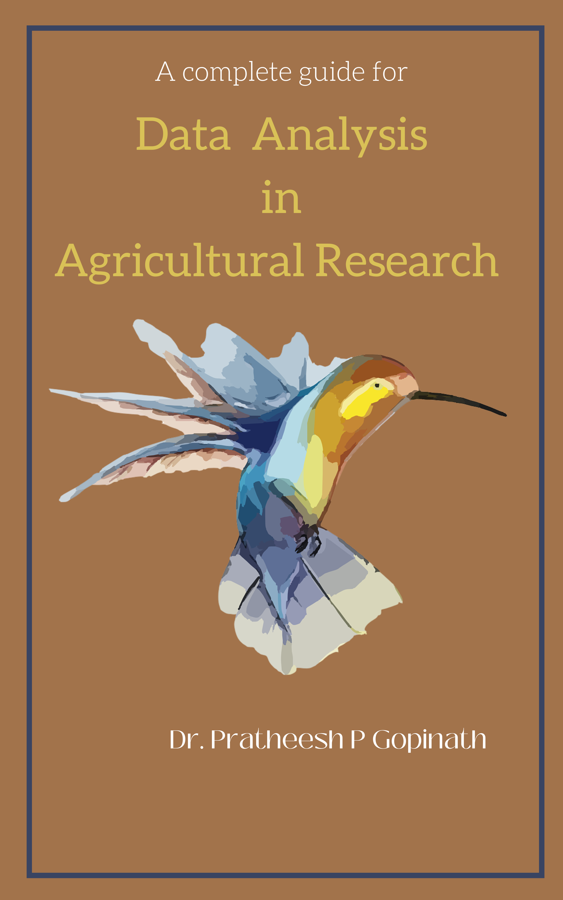

```{r setup-global, include=FALSE}
knitr::opts_chunk$set(
  comment = "#>",
  collapse = FALSE,
  fig.align = "center",
  out.width = "80%",
  fig.width = 7,
  fig.asp = 0.62,
  message = FALSE,
  warning = FALSE
)
options(digits = 4, width = 80, scipen = 6)
set.seed(531)

# Create a bib database of the R packages used in the book
knitr::write_bib(c(
  "base", "bookdown", "knitr", "rmarkdown", "agridat", "MASS",
  "car", "emmeans", "multcomp", "lme4", "lmerTest", "fitdistrplus", "vcd",
  "HistData", "psych", "FactoMineR", "factoextra", "forecast", "TTR",
  "modeest", "pastecs", "readxl", "corrplot", "nortest", "lmtest"
), "packages.bib")
```

# Welcome {-}

```{r cover, echo=FALSE, out.width="45%"}

```

Welcome to the online version of **Data Analysis Using Statistical Packages**.

This book covers the complete syllabus of the course **STAT 531 – Data Analysis Using Statistical Packages**, offered in the Post Graduate programme of Kerala Agricultural University (KAU). It is written for M.Sc. and Ph.D. students of every agricultural discipline who need to analyse their own research data, and it doubles as a desk reference for researchers who want a worked R example for a familiar statistical procedure.

Every analysis in the book is carried out in **R**, the free and open-source statistical environment, using **RStudio** as the interface. All code is reproducible: the examples use data sets that ship with R or with freely available R packages, most of them real agricultural experiments (many taken from the classic text of @gomez1984).

The online version of this book is free to read and is published in **MeLoN** (Module for e-Learning & Online Notes) of the Department of Agricultural Statistics, College of Agriculture, Vellayani.

```{=html}
<a rel="license" href="https://creativecommons.org/licenses/by-nc-nd/4.0/"></a><br />This work is licensed under a <a rel="license" href="https://creativecommons.org/licenses/by-nc-nd/4.0/">Creative Commons Attribution-NonCommercial-NoDerivatives 4.0 International License</a>.
```

# Preface {-}

Agricultural research produces data from field experiments, surveys, laboratory assays and long-term monitoring. Turning those data into sound conclusions needs two things: a clear understanding of the statistical method, and the practical skill to carry it out on a computer. Most students learn the first in their theory courses but struggle with the second. This book is meant to close that gap.

## How this book is organised {-}

The chapters follow the five units of the STAT 531 syllabus (see the [Syllabus](#syllabus)):

- **Getting started** (Chapters \@ref(introduction)–\@ref(dataset)): statistical software, installing R and RStudio, R basics, packages, importing data and built-in data sets.
- **Unit I – Describing data** (Chapters \@ref(descriptive-statistics)–\@ref(eda)): summarisation and tabulation, descriptive statistics, graphs and exploratory data analysis.
- **Unit II – Distributions and tests of hypotheses** (Chapters \@ref(distributions)–\@ref(small-sample)): fitting distributions and testing goodness of fit, large-sample tests, and *t*, *F* and chi-square tests.
- **Unit III – Analysis of variance and covariance** (Chapters \@ref(anova-crd)–\@ref(ancova)): one-way ANOVA, multiple comparisons, standard experimental designs, factorial and split-plot experiments, contrasts and ANCOVA.
- **Unit IV – Mixed models and regression** (Chapters \@ref(mixed-models)–\@ref(regression)): mixed models, variance components, correlation and regression.
- **Unit V – Multivariate methods, non-linear models and time series** (Chapters \@ref(pca)–\@ref(time-series-analysis-using-r)).

Each chapter states the statistical model, shows the R code, explains how to read the output, and ends with exercises.

## Conventions {-}

R code is shown in grey boxes. Lines of output start with `#>`, so you can copy a whole box into R without editing:

```{r conventions}
mean(c(12, 15, 18))
```

Function names are written with parentheses, e.g. `aov()`, and package names in code font, e.g. `agricolae`. Notes and tips are highlighted like this:

::: {.rmdnote}
A note or tip contains practical advice, common mistakes or a pointer to further reading.
:::

## Software and packages {-}

The book was built with `r R.version.string`. The following packages are used. Install them once with:

```{r install-all, eval=FALSE}
install.packages(c(
  "agricolae", "agridat", "car", "emmeans", "multcomp", "lme4", "lmerTest",
  "fitdistrplus", "vcd", "HistData", "psych", "FactoMineR", "factoextra",
  "forecast", "TTR", "modeest", "pastecs", "readxl", "corrplot", "nortest",
  "lmtest"
))
```

`MASS` comes with every R installation.

## Prerequisites {-}

You should be familiar with basic statistical theory. For the theory behind the methods in this book, please refer to my e-book [Textbook of Agricultural Statistics](https://kaumelon.github.io/stat3202/) and to standard texts such as @goon1983, @gupta1997, @snedecor1989 and @gomez1984.

## Acknowledgements {-}

The book is built with **bookdown** [@R-bookdown]. Chapter \@ref(time-series-analysis-using-r) is adapted from *A Little Book of R for Time Series* by Avril Coghlan [@coghlan2017], released under a Creative Commons Attribution 3.0 licence.

## Feedback {-}

If you find an error or have a suggestion, please contact [Dr. Pratheesh P. Gopinath](https://coavellayani.kau.in/people/dr-pratheesh-p-gopinath) (e-mail: `pratheesh.pg@kau.in`) or open an issue on [GitHub](https://github.com/KAUMELON/stat-531/issues). Thank you!

```{r logo, echo=FALSE, out.width="25%"}

```
